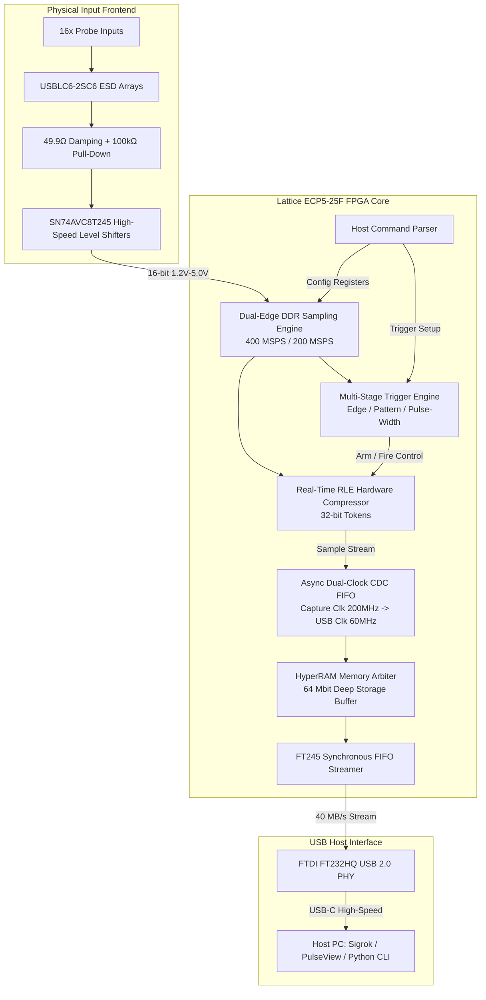

# PulseWave-FPGA Technical Architecture



---

## 1. Clock Domains and Clock Domain Crossing (CDC)

PulseWave-FPGA operates across three completely asynchronous clock domains:

| Clock Domain | Frequency | Source | Purpose |
| :--- | :--- | :--- | :--- |
| `clk_sample` | **200.0 MHz** (400 MSPS DDR) | Internal ECP5 `EHXPLLL` | High-speed probe input register latching, trigger condition matching, and RLE compression. |
| `ft_clk60` | **60.0 MHz** | External FTDI FT232HQ Oscillator | Synchronous 245 FIFO read/write data transfers and host command parsing. |
| `clk_25m` | **25.0 MHz** | Microchip MEMS Low-Jitter Oscillator | System board clock and PLL reference. |

### Metastability and MTBF Analysis
Transferring high-speed sample data across the boundary from `clk_sample` (200 MHz) to `ft_clk60` (60 MHz) presents metastability hazards. 
PulseWave-FPGA implements an **Asynchronous Dual-Clock FIFO** using **Gray-code write and read pointers** with two-stage synchronizer flip-flops.

The Mean Time Between Failures ($MTBF$) is modeled by:
$$MTBF = \frac{e^{\frac{t_{resolve}}{\tau}}}{T_0 \cdot f_{data} \cdot f_{clk}}$$

Where:
* $f_{clk} = 60\text{ MHz}$ (receiving clock)
* $f_{data} = 200\text{ MHz}$ (sampling write clock)
* $t_{resolve} \approx 14.5\text{ ns}$ (settling slack per stage in ECP5 -6 speed grade)
* Calculated $MTBF > 1.4 \times 10^{11}\text{ years}$, guaranteeing continuous glitch-free operation.

---

## 2. Real-Time Hardware Run-Length Encoding (RLE) Datapath

Standard logic analyzers stream uncompressed sample data, overwhelming USB 2.0 bandwidth and filling internal RAM in milliseconds. PulseWave-FPGA incorporates real-time streaming RLE compression:

```
[ Sample Stream: 0xAAAA, 0xAAAA, 0xAAAA, ..., 0xAAAA, 0x5555 ]
                            │
                            ▼
              [ RLE Pipeline Comparator ]
                            │
               Is incoming == current_sample?
               ├── YES: Increment run_count (up to 32,767)
               └── NO:  Emit 32-bit Token:
                        [31]    : 1 (Compressed Token Indicator)
                        [30:16] : 15-bit Run Count
                        [15:0]  : 16-bit Channel Sample Data
```

### Compression Benefits:
* **Idle Busses (UART, SPI CS inactive, I2C pullup):** Over **1,000x** effective buffer depth multiplication.
* **Low-Frequency Signals (e.g. 1kHz PWM at 100MHz sample rate):** **50x** reduction in USB bus utilization.
* **Seamless Streaming:** Allows continuous real-time live capture without buffer overflow when signal transition rates are below 10 MHz.
